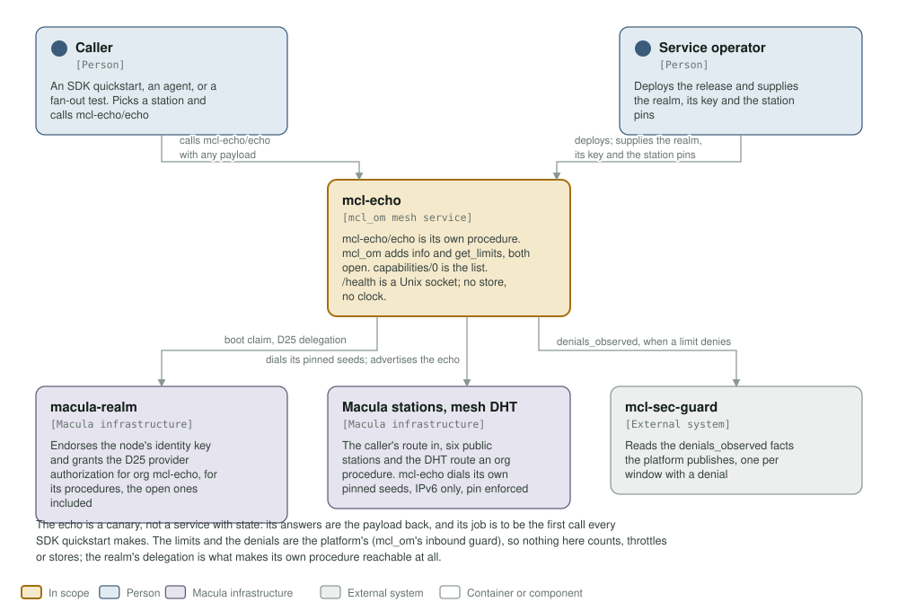
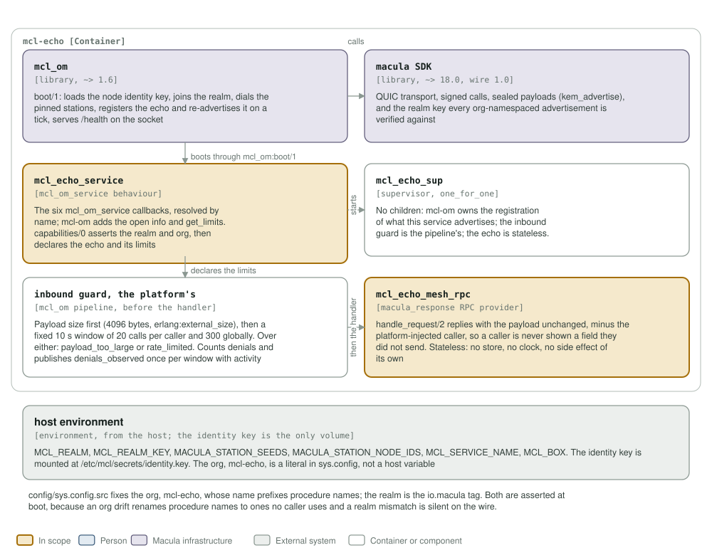

# mcl-echo architecture: C4 model

*This exists so a reader can see what mcl-echo talks to, and what it is made of,
without reading it.*

**Status: live on the PQ fleet.** One OTP release in one container, serving
`mcl-echo/echo` through the standard `mcl_om` capability path, and answering
`/health` on `/run/mcl/health.sock`. The handler replies with the payload
unchanged, minus the platform-injected `caller`. It opens no store, mounts no
data volume and keeps no state.

## Level 1: system context

| Element | Kind | Role |
| --- | --- | --- |
| mcl-echo | In scope | `mcl-echo/echo` is its own procedure, and the only one; `mcl_om` adds `mcl-echo/info` and `mcl-echo/get_limits` to every service, both open; `capabilities/0` is the list. It is the first call every SDK quickstart makes, and `/health` is on the Unix socket. One `mcl_om` mesh service in one container |
| Caller | Person | An SDK quickstart, an agent, or a fan-out test. Picks one of the six public stations as its route into the mesh and calls `mcl-echo/echo` |
| Service operator | Person | Deploys the release and supplies `MCL_REALM`, `MCL_REALM_KEY`, and the station seeds with their node ids |
| macula-realm | Macula infrastructure | Endorses the node's identity key and issues the D25 delegation for org `mcl-echo`, whose procedure it names. Its public key (`MCL_REALM_KEY`) is the trust anchor for every advertisement |
| Macula stations, mesh DHT | Macula infrastructure | The caller's route in, and the DHT that routes an org procedure. The service dials its own pinned seeds; the 11.x dial is pinned to the station's node id, and the fleet is IPv6 only |
| mcl-sec-guard | External system | Reads the `denials_observed` facts the platform publishes, one per window with activity |

The echo is a canary, not a service with state: its answers are the payload back.
The payload cap and the rate limit are the platform's (mcl-om's inbound guard),
not this service's, so nothing here counts, throttles or stores. The realm's
delegation is what makes the procedure reachable at all: the org and the realm
are deploy config, and `capabilities/0` asserts both are configured and well
formed rather than advertising where nobody can find it.

## Level 2: containers and components

| Component | Technology | Responsibility |
| --- | --- | --- |
| `mcl_echo_service` | Erlang, the `mcl_om_service` behaviour | The six callbacks `mcl_om` resolves by name: `info/0`, `start/1`, `stop/1`, `health/0`, `capabilities/0`, `identity_spec/0`. `capabilities/0` asserts the realm tag and the org, then declares the echo and its limits. `identity_spec/0` asks for scope `mcl-echo` with no actions and no resources |
| `mcl_echo_sup` | supervisor, `one_for_one` | No children. The capability registration is mcl_om's, the inbound guard is the pipeline's, and the echo is a stateless handler, so an empty child list is the honest shape |
| inbound guard, the platform's | the `mcl_om` pipeline, before the handler | Payload size first (`max_payload_external_size` 4096, measured with `erlang:external_size/1`), then a fixed 10 s window of 20 calls per caller and 300 globally. Over either: `payload_too_large` or `rate_limited`. It counts denials and publishes `denials_observed` once per window with activity |
| `mcl_echo_mesh_rpc` | `macula_response` RPC provider | `handle_request/2` replies with the payload unchanged, minus the platform-injected `caller`. Stateless: no store, no clock, no side effect of its own |
| `mcl_om` | library, `~> 1.4` | `boot/1`: loads the node identity key, joins the realm, dials the pinned stations, registers the echo and re-advertises it on a tick, and serves `/health` |
| macula SDK | library, `~> 16.0`, wire 1.0 | QUIC transport, signed calls, sealed payloads (`kem_advertise`), and the realm key every org-namespaced advertisement is verified against |
| host environment | from the host | `MCL_REALM`, `MCL_REALM_KEY`, `MACULA_STATION_SEEDS`, `MACULA_STATION_NODE_IDS`, `MCL_SERVICE_NAME`, `MCL_BOX`, and the node identity key at `/etc/mcl/secrets/identity.key`, the only volume |

`config/sys.config.src` fixes the org, `mcl-echo`, which prefixes the procedure,
and the realm is the `io.macula` tag. Both are asserted at boot, because an org
drift renames the procedure to a name no caller uses and a realm mismatch is
silent on the wire (`unknown_next_peer`, indistinguishable from nobody
listening). The inbound guard's alert topic and the guardian gate are an optional
`inbound_guard` block in the same file, commented out by default; the limits
themselves are declared in code, in `capabilities/0`.

**Where the station list comes from.** It is not in `config/sys.config.src`: `mcl_om` reads `MACULA_STATION_SEEDS` and `MACULA_STATION_NODE_IDS` from the environment at boot, paired index for index, so this repository pins no station and the list may be any length.

## Drawing them

`assets/c4-context.svg` and `assets/c4-components.svg` are generated by
`architecture/c4_diagrams.py` (`python3 architecture/c4_diagrams.py`), from the
code and never from this page: the callbacks and the capability in
`mcl_echo_service.erl`, the handler in `mcl_echo_mesh_rpc.erl`, the supervisor,
the dependencies in `rebar.config`, the org and realm in `config/sys.config.src`,
and the station list in `mcl_echo_stations.erl`. When one of those changes, the
diagram changes in the same commit.

Two rules for the files themselves, so they render everywhere they are read
(GitHub, an IDE, `rsvg-convert`): self-contained SVG, and literal colours in plain
classes plus a `prefers-color-scheme` dark block, never CSS custom properties,
which `rsvg-convert` renders black. The generator refuses to write a box that is
too small for its own text or a line wider than its box, so a stale box fails the
run rather than overlapping the next one.

The check that keeps them here is the `c4-model` job in
`.github/workflows/c4-model.yml`. It is red until both files exist and are
shown, and it stays red if either one goes missing. A diagram-only commit does
not rebuild the image: `assets/**` is in `build-push.yml`'s `paths-ignore`.
